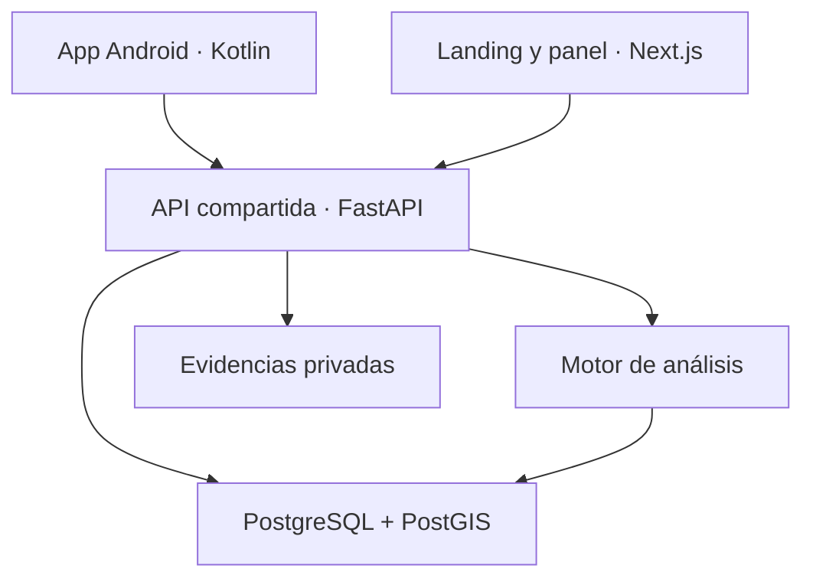

# Conectar la futura app móvil con la web

Esta guía describe la siguiente implementación. **Las tecnologías de esta tabla no están instaladas en el demo local.** La app Android ya envía reportes al servidor Python del demo (`POST /api/reports`, `POST /api/track`); ver «Conectar la app Android» en el README. El ZIP usa HTML/CSS/JavaScript, Python estándar y SQLite para permitir una prueba sin servicios externos.

## Arquitectura propuesta y situación actual

| Parte | Herramienta propuesta | Función |
| --- | --- | --- |
| App Android | Kotlin/Gradle en tu proyecto actual | Mantener el formulario móvil, permisos, ubicación, imagen y seguimiento; conectar su capa de datos a la API. Expo fue una alternativa preliminar del artículo. |
| Landing y panel | Next.js | Presentación pública, filtros, gráficos y área de revisión. |
| Mapas | Leaflet local o Google Maps, ya implementados en esta web | Capas, celdas, marcadores y visualización del calor. |
| API compartida | Python con FastAPI | Validar solicitudes, aplicar roles y servir datos públicos/privados. |
| Análisis | Python y scikit-learn | DBSCAN y evaluación de parámetros; después, comparación con una línea base. |
| Datos | Supabase, PostgreSQL y PostGIS | Persistencia, consultas espaciales e índices geográficos. |
| Identidad y archivos | Supabase Auth y Storage privado | Cuentas con roles y evidencias mediante accesos temporales autorizados. |
| Desarrollo | VS Code, Android Studio, Git/GitHub y emulador Android | Código compartido, control de versiones y pruebas. |



La app no se conecta al archivo HTML de la landing. La app y el panel llaman al mismo backend. Puedes alojar landing y panel como rutas del mismo proyecto web; no necesitas dos sitios separados por obligación.

## Recorrido de un dato

1. La persona inicia sesión en la app, permite obtener una ubicación puntual y confirma dónde ocurrió el hecho. No se necesita rastreo continuo en segundo plano.
2. La app Android envía un JSON a `POST https://TU_API/api/reports` y una credencial de sesión válida. La evidencia se transfiere a un almacenamiento privado autorizado.
3. FastAPI verifica el token y los campos, asigna el estado inicial `recibido` y guarda el reporte en PostgreSQL. Las coordenadas se guardan también en un campo geográfico PostGIS con índice espacial.
4. La persona revisora accede al panel con su propio rol, examina la información y sus posibles coincidencias, y registra la decisión en un historial.
5. Python procesa reportes elegibles y actualiza los agregados del periodo. DBSCAN usa metros o una métrica geográfica correcta; no se deben tratar grados como metros.
6. El panel solicita `GET /api/stats?...` y dibuja las capas. Puede consultar al cambiar filtros y ofrecer actualización manual; la actualización en tiempo real se agrega si el uso la justifica.
7. La web pública recibe únicamente la salida preparada para publicación. Los registros individuales y las fotos requieren un rol autorizado.

En el móvil, `localhost` no es tu PC ni un servidor remoto. Durante desarrollo se usa la IP del PC en la red local o una URL HTTPS de desarrollo; en producción se configura la URL HTTPS real de la API.

## Contrato de este demo

| Método y ruta | Acceso | Entrada / salida principal |
| --- | --- | --- |
| `GET /api/config` | Público | Tipos de robo, área ilustrativa, fecha/hora del servidor y estados. |
| `POST /api/reports` | Público, solo demo | Crea un reporte y entrega identificador + código privado. Acepta `value_band` (`sin_dato`, `bajo`, `medio`, `alto`, `muy_alto`), `force` (`sin_violencia`, `amenaza`, `violencia`, `sin_dato`) y `circumstances` (lista: `dos_o_mas`, `casa_habitada`, `destreza`, `vehiculo_medio`, `uso_momentaneo`). Todos opcionales. |
| `GET /api/stats` | Público | Recibe `days=7/30/90`, `subtype=all/persona/negocio/vivienda/vehiculo`, `band=all/0/1/2/3`, `family=all/hurto/robo`. Entrega conteos, serie temporal, franjas y celdas publicables. |
| `GET /api/evaluate` | Público | Escenario sintético: `size`, `eps`, `min_samples` y `seed`; coincidencias, precisión, cobertura, F1 y tiempo. |
| `GET /api/admin/metrics` | Revisor | Mismos filtros del panel; estados, prioridades, mediana de revisión, calidad y `alerts` (eventos graves y zonas por índice de daño). |
| `GET /api/export.csv` | Público | Mismos filtros; descarga únicamente celdas agregadas. |
| `POST /api/track` | Código privado | Consulta estado/historial sin mostrar detalles del hecho. |
| `POST /api/login` | Credencial demo | Crea una sesión de revisión de 8 horas. |
| `POST /api/logout` | Sesión | Revoca la sesión actual. |
| `GET /api/admin/reports` | Revisor | Reportes individuales, puntajes y posibles coincidencias. |
| `POST /api/admin/status` | Revisor | Cambia estado, exige nota y, para duplicados, ID original. `legal_class` opcional confirma o corrige la figura legal. |
| `GET /api/admin/actions` | Revisor | Acciones registradas con su evaluación (antes/durante, resto del área, veredicto) y zonas disponibles. |
| `POST /api/admin/actions` | Revisor | Registra una acción: `zone`, `title`, `responsible`, opcionales `start_date`, `end_date`, `band`, `schedule`, `source`. |
| `POST /api/admin/actions/update` | Revisor | Cambia `status` (`planificada`, `en_curso`, `finalizada`, `cancelada`) y `notes`. |
| `POST /api/admin/ai-analysis` | Revisor | Mismos filtros en el cuerpo JSON (+ `refresh`). Devuelve `analysis` (resumen, zonas con acciones, patrones, limitaciones), `source` (`claude` o `reglas`), `context` enviado y `map_cells`. |
| `GET /api/admin/evidence/ID` | Revisor | Sirve la imagen privada. |

Ejemplo de cuerpo de registro (reemplazar fecha/hora por una fecha pasada válida):

```json
{
  "subtype": "persona",
  "occurred_at": "2026-10-24T08:00:00-05:00",
  "description": "Caso ficticio de robo a una persona para demostrar el flujo.",
  "lat": -16.357,
  "lng": -72.187,
  "weapon": false,
  "injury": false,
  "value_band": "medio",
  "force": "amenaza",
  "circumstances": ["dos_o_mas"],
  "consent": true,
  "photo": null
}
```

`photo`, si existe, es una imagen JPEG codificada en base64, sin el prefijo `data:`. Este formato simplifica el demo; para producción conviene una carga de archivo controlada y almacenamiento privado.

## Orden recomendado para convertirlo en el proyecto final

1. Formalizar alcance: solo robos en Majes, datos mínimos, roles y estados. Corregir el título del artículo que aún incluye hurtos y el párrafo ajeno sobre residuos sólidos.
2. Migrar el esquema a PostgreSQL/PostGIS y crear pruebas de acceso. Separar datos de prueba de datos reales con entornos distintos.
3. Implementar autenticación y autorización en FastAPI; aplicar RLS cuando se expongan tablas por Supabase. La clave `service_role` nunca debe ir en la app Android ni en el JavaScript del navegador.
4. Conectar el flujo de reporte y seguimiento de tu app Android Kotlin, reutilizando las reglas de validación y el contrato de API. No hace falta migrar a Expo.
5. Mantener el panel modular o migrarlo a Next.js si el alcance lo justifica. Leaflet y el adaptador Google ya están implementados; seleccionar la cartografía y el proveedor adecuados al tráfico esperado.
6. Incorporar evidencia privada, validación de imagen en servidor, límites de carga, rate limiting, prevención de abuso y auditoría por usuario.
7. Calibrar DBSCAN y la prioridad con escenarios de referencia y revisión de especialistas. Separar la prioridad operativa de la calidad o completitud del registro.
8. Ejecutar un piloto consentido y autorizado, con políticas de publicación, conservación y eliminación definidas para los datos realmente recogidos.

## Mejoras de impacto para evaluar después

| Mejora | Resultado que aporta | Cómo verificarla |
| --- | --- | --- |
| Calidad y duplicados | Menos distorsión en las estadísticas. | Precisión/recall sobre pares de reportes etiquetados manualmente. |
| Comparación temporal (ya implementada; falta validar con datos de campo) | Identificar cambios en los reportes. | Periodos comparables, tamaño de muestra y revisión del subregistro. |
| Acciones preventivas registradas (implementado en `/acciones`) | Conectar la información con decisiones documentadas. | Relacionar zona/periodo, acción, responsable y seguimiento; no atribuir causalidad automáticamente. |
| Modo sin conexión | Facilitar el registro donde hay conectividad intermitente. | Cola local, reintentos, confirmación de recepción e idempotencia. |
| Seguimiento y avisos | Dar visibilidad al proceso de revisión. | Entrega de notificaciones y comprensión del estado por participantes. |
| Evaluación de usabilidad | Demostrar que la solución se puede utilizar. | Tiempo de registro, errores, tareas completadas y SUS con un protocolo definido. |

El aporte defendible es **transformar reportes en información territorial revisada y explicable**. Una mejora en el tiempo de registro no equivale por sí sola a una reducción del delito. Para afirmar impacto social real hará falta una evaluación adicional con actores locales y condiciones de comparación adecuadas.

## Documentación oficial consultada

- Expo Location: https://docs.expo.dev/versions/latest/sdk/location/
- Expo ImagePicker: https://docs.expo.dev/versions/latest/sdk/imagepicker/
- Supabase/PostGIS: https://supabase.com/docs/guides/database/extensions/postgis
- Supabase RLS: https://supabase.com/docs/guides/database/postgres/row-level-security
- FastAPI: https://fastapi.tiangolo.com/
- Next.js: https://nextjs.org/docs
- Leaflet: https://leafletjs.com/examples/quick-start/
- DBSCAN en scikit-learn: https://scikit-learn.org/stable/modules/generated/sklearn.cluster.DBSCAN.html

La referencia visual solicitada fue https://alerta.munipaucarpata.gob.pe/ . La lectura directa devolvió un bloqueo 403; se consultó información pública indexada. El diseño, nombre e implementación del demo son propios y no reproducen su código, marca o recursos.
